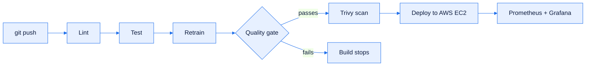

<div align="center">


<a href="https://git.io/typing-svg">
  
</a>

<br>
<br>


<a href="https://ruchitasingla.github.io/Portfolio/">
  
</a>


</div>

---

## `~$ whoami`

### About me

```python
class Ruchita:
    def __init__(self):
        self.role      = "Machine Learning & MLOps Engineer (Fresher)"
        self.education = "B.Tech CSE @ JUIT (2022 – 2026)"
        self.location  = "India"
        self.languages = ["Python", "SQL", "C++"]
        self.focus     = ["Machine Learning", "CI/CD & Automation", "Cloud Deployment"]
        self.learning  = ["Kubernetes", "Terraform"]
        self.status    = "Open to Work"

    def philosophy(self):
        return "Learn by building. Ship models that are tested, secure and monitored."
```

- I train and evaluate **ML models** with Python and Scikit-learn
- I automate **testing, security scanning, deployment and monitoring** with Jenkins, GitHub Actions and Docker
- I deploy ML services on **AWS EC2** and watch them with **Prometheus and Grafana**
- Currently learning **Kubernetes** and **Terraform**
- See my work on my portfolio: **[ruchitasingla.github.io/Portfolio](https://ruchitasingla.github.io/Portfolio/)**

```bash
$ ./pipeline --run ruchita
[ok] lint ........ clean, tested code
[ok] test ........ models validated before release
[ok] scan ........ images checked with Trivy
[ok] deploy ...... AWS EC2, automated
[ok] monitor ..... Prometheus + Grafana
$ status: open_to_work
```

### Experience

**Machine Learning Intern** · Yhills Edutech Pvt. Ltd. (Remote) · `Jun 2025 – Jul 2025`

- Built data cleaning and preprocessing workflows in Python and Pandas
- Ran exploratory data analysis and feature preparation
- Trained and evaluated regression and classification models with Scikit-learn

### Education

**B.Tech in Computer Science & Engineering** · Jaypee University of Information Technology (JUIT)
`2022 – 2026` · **CGPA: 7.7 / 10**

---

## `~$ ls ./stack`

### Machine Learning & Data
<p>
  
  
  
  
  
  
</p>

### CI/CD & DevOps
<p>
  
  
  
  
  
  
</p>

### Cloud, Backend & Monitoring
<p>
  
  
  
  
  
  
</p>

### Currently Learning
<p>
  
  
</p>

---

## `~$ cat ./projects.log`

### Churn MLOps · End-to-End ML Pipeline with CI/CD

A GitHub Actions pipeline that **lints, tests, retrains, validates, scans and deploys** a churn model to AWS EC2 on every push to `main`.

- **Model quality gate** (minimum ROC AUC plus regression checks) blocks weaker models
- Experiments tracked with **MLflow**
- **Trivy** found three HIGH-severity vulnerabilities in a dependency, fixed by upgrading FastAPI
- **Prometheus** metrics and **Grafana** dashboards for API performance and prediction drift

**Built with:** `Python` `FastAPI` `MLflow` `Docker` `GitHub Actions` `AWS EC2` `Prometheus` `Grafana`

<a href="https://github.com/ruchitasingla/churn-mlops">

</a>



---

### Mental Health Signal · ML App with Jenkins CI/CD on AWS

Predicts a student's **mental health score (0 to 10)** from daily habits like sleep, screen time, study hours and stress.

- Random Forest trained on **5,000 records** and **12 features**: **R² 0.878, MAE 0.35** on held-out data
- One Scikit-learn Pipeline, so training and serving use identical preprocessing
- Served with **FastAPI** behind **Nginx** and packaged as Docker images with Docker Compose
- **Jenkins** pipeline on every push: ruff lint, pytest, build, Trivy scan, Docker Hub push, deploy to AWS EC2 and a smoke test

**Built with:** `Python` `Scikit-learn` `FastAPI` `Docker` `Jenkins` `Trivy` `AWS EC2` `Nginx`

<a href="https://github.com/ruchitasingla/mental_health_recorder">

</a>

---

### Customer Behavior Analysis · Data Analytics

An end-to-end analytics workflow (data preparation, modeling, SQL analysis, visualization and reporting) that turns raw customer data into insights on purchasing behavior, segments and loyalty.

**Built with:** `Python` `Pandas` `PostgreSQL` `Power BI`

<a href="https://github.com/ruchitasingla/Customer_behavior_analysis">

</a>

---

## `~$ gh stats --user ruchitasingla`

<div align="center">


</div>

---

## `~$ ./connect.sh`

<div align="center">

<a href="https://ruchitasingla.github.io/Portfolio/">
  
</a>
<a href="https://www.linkedin.com/in/ruchita-singla/">
  
</a>
<a href="mailto:ruchitasingla001@gmail.com">
  
</a>
<a href="https://github.com/ruchitasingla">
  
</a>

<br><br>

<i>Open to internships and full-time roles in Machine Learning and MLOps.</i>

<br><br>


</div>
