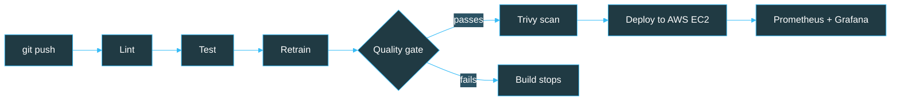

<!-- ===================== HEADER BANNER ===================== -->
<div align="center">


<a href="https://git.io/typing-svg">
  
</a>

<br>
<br>


<a href="https://ruchitasingla.github.io/Portfolio/">
  
</a>


</div>


## 👩‍💻 About Me

```python
class Ruchita:
    def __init__(self):
        self.role      = "Machine Learning & MLOps Engineer (Fresher)"
        self.education = "B.Tech CSE @ JUIT (2022 – 2026)"
        self.location  = "India 📍"
        self.languages = ["Python", "SQL", "C++"]
        self.focus     = ["Machine Learning", "CI/CD & Automation", "Cloud Deployment"]
        self.learning  = ["Kubernetes", "Terraform"]
        self.status    = "Open to Work 💼"

    def philosophy(self):
        return "Learn by building. Ship models that are tested, secure and monitored."
```

- 🤖 I train and evaluate **ML models** with Python and Scikit-learn
- ⚙️ I automate **testing, security scanning, deployment and monitoring** with Jenkins, GitHub Actions and Docker
- ☁️ I deploy ML services on **AWS EC2** and watch them with **Prometheus and Grafana**
- 🌱 Currently learning **Kubernetes** and **Terraform**
- 🌐 See all my work on my portfolio: **[ruchitasingla.github.io/Portfolio](https://ruchitasingla.github.io/Portfolio/)**
- 💬 Ask me about **ML pipelines, CI/CD, Docker, FastAPI, Scikit-learn and SQL**


## ⚡ Tech Stack

### 🤖 Machine Learning & Data
<p>
  
  
  
  
  
  
  
</p>

### ⚙️ CI/CD & DevOps
<p>
  
  
  
  
  
  
</p>

### ☁️ Cloud, Backend & Monitoring
<p>
  
  
  
  
  
  
</p>

### 🗄️ Databases & Visualization
<p>
  
  
</p>

### 🌱 Currently Learning
<p>
  
  
</p>


## 🚀 Featured Projects

<table>
<tr>
<td width="50%" valign="top">

### 🔁 Churn MLOps


An end-to-end pipeline that **lints, tests, retrains, validates, scans and deploys** a churn model to AWS EC2 on every push to `main`.

**⚙️ Built with**
`Python` `FastAPI` `MLflow` `Docker` `GitHub Actions` `AWS EC2` `Prometheus` `Grafana`

**🔍 What I did**
- Model quality gate (minimum ROC AUC plus regression checks) that blocks weaker models
- Experiment tracking with MLflow
- Found 3 HIGH-severity CVEs with Trivy and fixed them by upgrading FastAPI
- Prometheus metrics and Grafana dashboards for API performance and prediction drift

<a href="https://github.com/ruchitasingla/churn-mlops">

</a>

</td>

<td width="50%" valign="top">

### 🧠 Mental Health Signal


Predicts a student's **mental health score (0 to 10)** from daily habits like sleep, screen time, study hours and stress.

**⚙️ Built with**
`Python` `Scikit-learn` `FastAPI` `Docker` `Jenkins` `Trivy` `AWS EC2` `Nginx`

**🔍 What I did**
- Random Forest on 5,000 records and 12 features: R² 0.878, MAE 0.35
- One Scikit-learn Pipeline so training and serving use identical preprocessing
- FastAPI behind Nginx, packaged as Docker images with Docker Compose
- Jenkins pipeline: lint, test, build, Trivy scan, Docker Hub push, AWS EC2 deploy and smoke test

<a href="https://github.com/ruchitasingla/mental_health_recorder">

</a>

</td>
</tr>
<tr>
<td colspan="2" valign="top">

### 🛍️ Customer Behavior Analysis


An end-to-end analytics workflow (data preparation, modeling, SQL analysis, visualization and reporting) that turns raw customer data into insights on purchasing behavior, segments and loyalty.

**⚙️ Built with** `Python` `Pandas` `PostgreSQL` `Power BI`

<a href="https://github.com/ruchitasingla/Customer_behavior_analysis">

</a>

</td>
</tr>
</table>

### 🔁 How the Churn MLOps pipeline works




## 💼 Experience

<table>
<tr>
<td>

### 🤖 Machine Learning Intern
**Yhills Edutech Pvt. Ltd.** · Remote &nbsp;|&nbsp; `Jun 2025 – Jul 2025`


- 🧹 Built data cleaning and preprocessing workflows in Python and Pandas
- 🔎 Ran exploratory data analysis and feature preparation
- 📈 Trained and evaluated regression and classification models with Scikit-learn

</td>
</tr>
</table>


## 🎓 Education

<table>
<tr>
<td>

**Jaypee University of Information Technology (JUIT)**
🎓 B.Tech in Computer Science & Engineering
📅 2022 – 2026 &nbsp;|&nbsp; ⭐ **CGPA: 7.7 / 10**

</td>
</tr>
</table>


## 📊 GitHub Stats

<div align="center">


</div>


## 🤝 Let's Connect

<div align="center">

<a href="https://ruchitasingla.github.io/Portfolio/">
  
</a>
<a href="https://www.linkedin.com/in/ruchita-singla/">
  
</a>
<a href="mailto:ruchitasingla001@gmail.com">
  
</a>
<a href="https://github.com/ruchitasingla">
  
</a>

<br><br>

<i>🌐 More of my work: <a href="https://ruchitasingla.github.io/Portfolio/">ruchitasingla.github.io/Portfolio</a></i>

<i>💬 Open to internships and full-time roles in Machine Learning and MLOps.</i>

<br><br>


</div>
